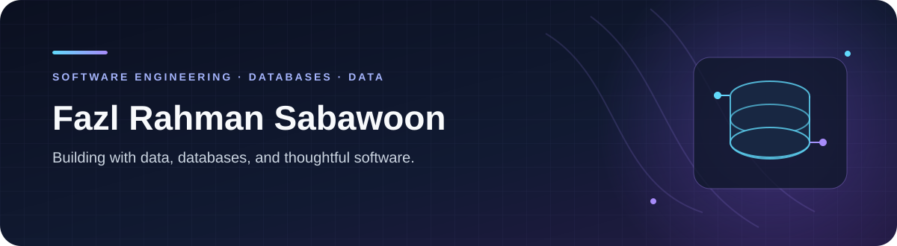
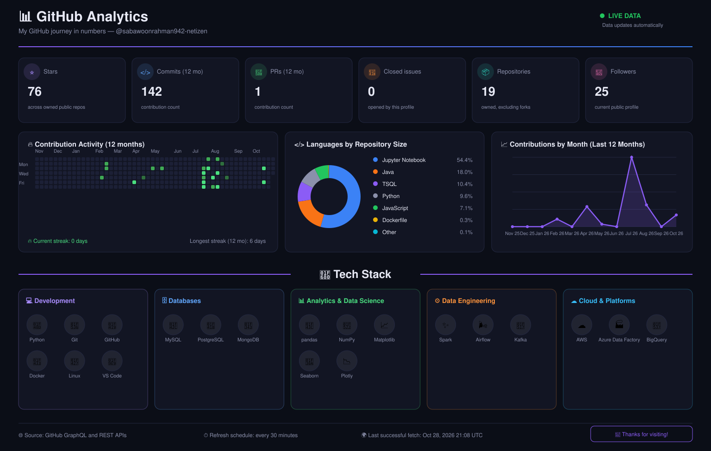

  
  
<strong>Software Engineering Student · Database & Data Engineering</strong>

  
Interested in database systems, data platforms, and building useful software around data.

---

## About

I’m a Software Engineering student with a focus on databases and data engineering. I’m especially interested in:

  <code>Database Systems</code> &nbsp; <code>Data Pipelines</code> &nbsp; <code>Analytics & Visualization</code>

## Featured Project

**[todo-api](https://github.com/sabawoonrahman942-netizen/todo-api)**  
A PostgreSQL-backed REST API for managing tasks and categories, with Docker setup and OpenAPI documentation.

## Toolbox

  

  <strong>Analytics:</strong> pandas · NumPy · Matplotlib · Seaborn · Plotly · Power BI · Tableau
   
  <strong>Data Engineering:</strong> Spark · Airflow · Kafka · Azure Data Factory · BigQuery

## GitHub Analytics

  

  
   
  Dashboard data refreshes on a 30-minute schedule. The last successful fetch time appears in the dashboard; GitHub may delay scheduled runs.

